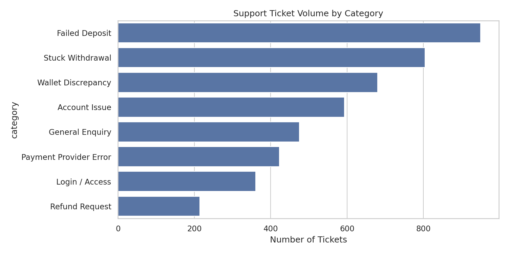
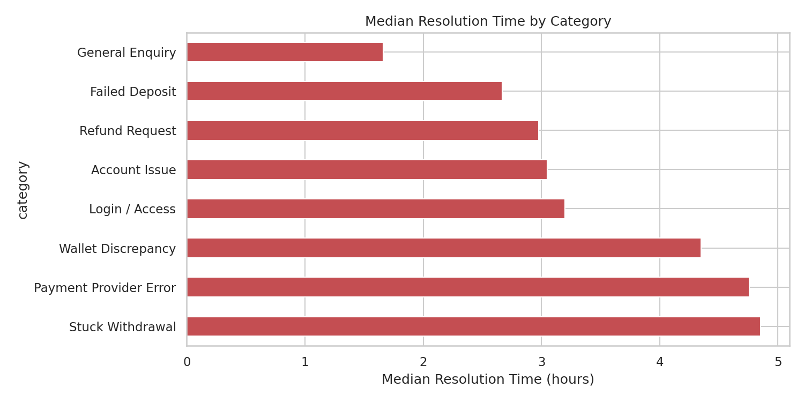
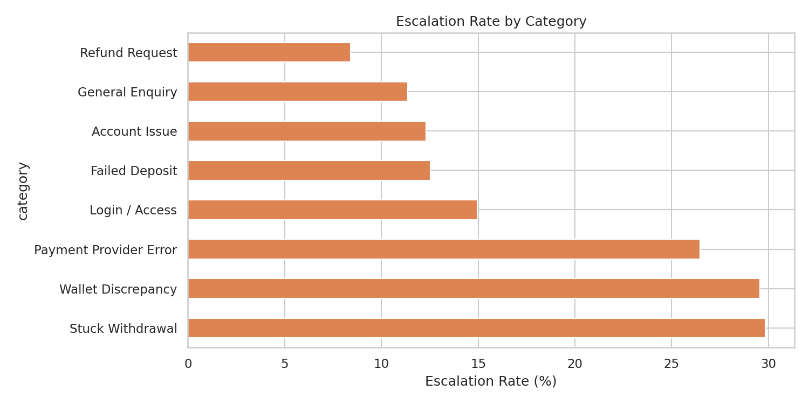
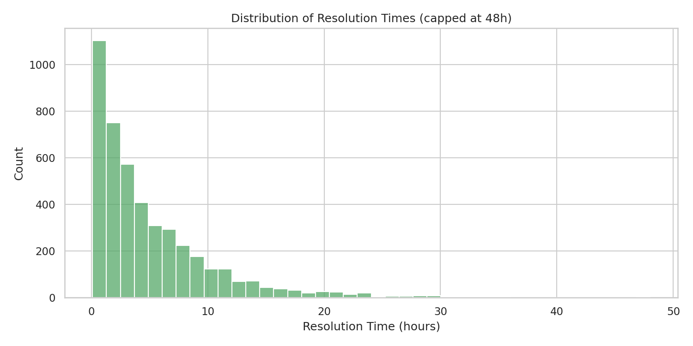
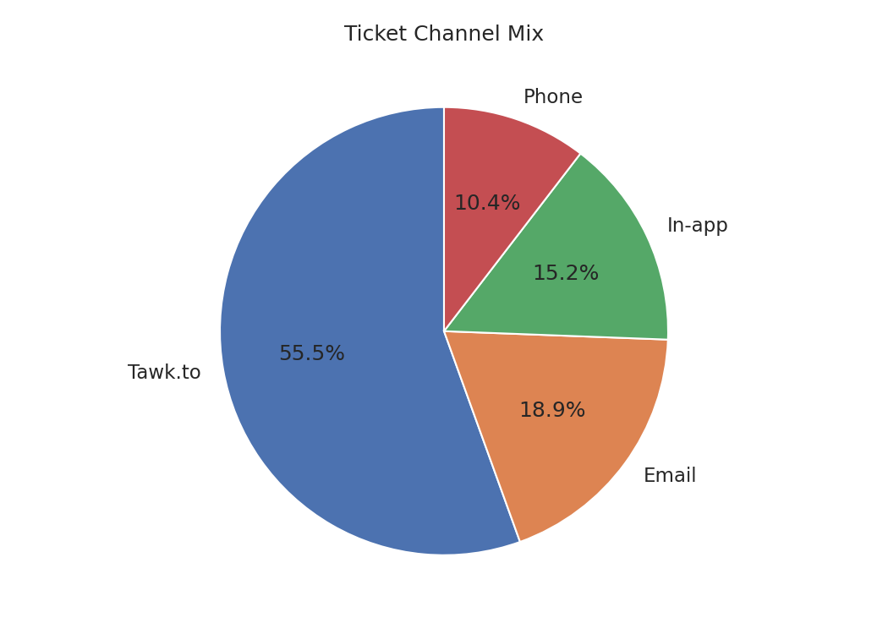

# Support Ticket / Incident Analysis

**Author:** [Omololu Oyewumi](https://www.linkedin.com/in/omololu-oyewumi-4aa682331)  
**Stack:** Python · Pandas · Matplotlib · Seaborn

---

## Problem Statement

Support teams in fintech are flooded with tickets about failed deposits, stuck withdrawals, and wallet discrepancies. Without clear visibility into which categories take longest and which escalate most, the team stays reactive.  

This project analyses synthetic support-ticket data (modelled on Jira + live-chat patterns) to surface volume, resolution-time bottlenecks, and escalation rates by category, priority and channel — so operations can focus improvement effort where it will reduce load the most.

**No real customer or company data was used.** All data is synthetic.

---

## Overview

- **4,500** synthetic support tickets over ~90 days  
- Overall escalation rate: **19.4%**  
- Median resolution time: **3.3 hours**

---

## Key Findings

**Highest volume categories**  
Failed Deposit · Stuck Withdrawal · Wallet Discrepancy

**Slowest to resolve (median hours)**  
- Stuck Withdrawal → 4.9 h  
- Payment Provider Error → 4.8 h  
- Wallet Discrepancy → 4.4 h  

**Highest escalation rates**  
- Stuck Withdrawal → 29.9%  
- Wallet Discrepancy → 29.6%  
- Payment Provider Error → 26.5%  

These three categories are the same operational problems analysed in the Transaction Failure and Wallet Reconciliation projects. Improving root-cause visibility on them would reduce both resolution time and escalation load.

### Ticket Volume by Category


### Median Resolution Time by Category


### Escalation Rate by Category


### Resolution Time Distribution


### Channel Mix


---

## Business Implications

- Prioritise root-cause work on Wallet Discrepancy, Stuck Withdrawal and Payment Provider Error tickets  
- These categories both take longer *and* escalate more often  
- Tawk.to-style live chat is the dominant channel → real-time support quality matters most  

---

## How to Run the Dashboard

```bash
# Install dependencies
pip install -r ../requirements.txt

# Launch the interactive dashboard
streamlit run app.py
```

The dashboard opens in your browser with KPIs, filters and interactive charts on one page.

### Optional: Regenerate data / static charts
```bash
python scripts/generate_data.py
python scripts/analyze.py
```


## Tech Stack

Python, Pandas, NumPy, Matplotlib, Seaborn, Faker

## Project Structure
```
├── app.py                          ← Streamlit dashboard (main entry)
├── data/
│   └── support_tickets.csv
├── scripts/
│   ├── generate_data.py
│   └── analyze.py
├── outputs/
│   ├── volume_by_category.png
│   ├── resolution_time_by_category.png
│   ├── escalation_by_category.png
│   ├── resolution_time_distribution.png
│   ├── channel_mix.png
│   └── insights_summary.txt
└── README.md
```

---

## Disclaimer

**Important:** All figures are from synthetic data generated to demonstrate analytical methodology and dashboard design. They do **not** represent real-world performance of any payment provider or platform.

All ticket volumes, resolution times and escalation rates are synthetic and generated to demonstrate methodology. They do not represent any real company’s support metrics.

---

**Connect with me:** [LinkedIn](https://www.linkedin.com/in/omololu-oyewumi-4aa682331)
